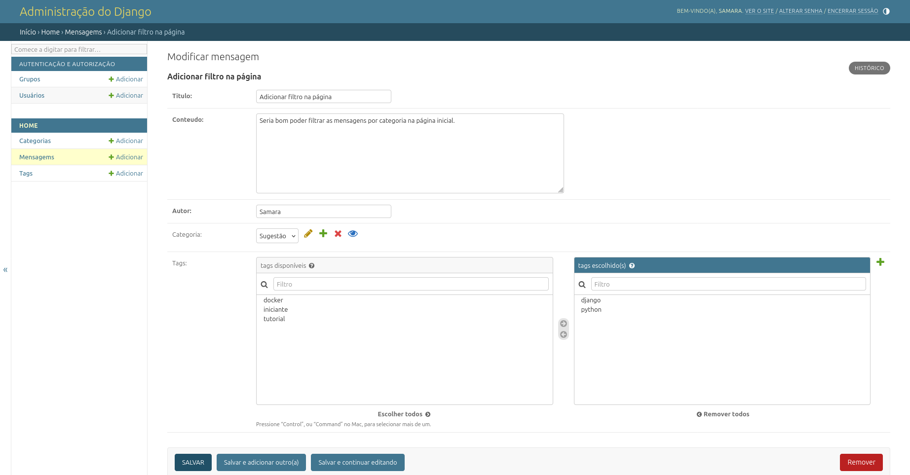
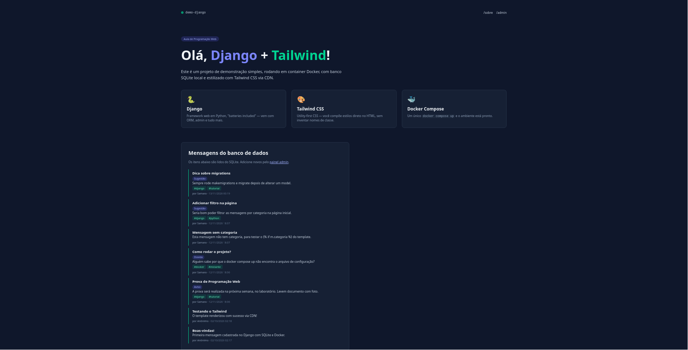

# Programação Web 

**Instituição:** Universidade Federal de Ouro Preto (UFOP)  
**Curso:** Ciência da Computação  
**Disciplina:** Programação Web  
**Professora:** Aline  
**Aluna:** Samara Paloma Lopes Augusto Ribeiro  

Repositório destinado ao armazenamento das atividades, roteiros práticos e projetos desenvolvidos ao longo da disciplina.

---

## Ementa
- Introdução à Internet, World Wide Web e sociedade da informação.
- Aplicações Web: evolução e arquitetura.
- Linguagens de marcação (HTML/HTML5, XML) e folhas de estilos (CSS).
- Programação do lado do cliente (Tailwind CSS, frontend).
- Abordagens e tecnologias do lado do servidor (Python & Framework Django - MTV).
- Padrões de projeto, requisitos de qualidade (usabilidade, desempenho, acessibilidade) e serviços Web.

---

## 📍 Roteiros Práticos

### Backend (Django)
- [x] **Roteiro 05:** Introdução ao Django (Projeto Inicial)
- [x] **Roteiro 06:** Criando modelos e rotas com Django
- [x] **Roteiro 07:** Criando modelos e relacionamento com Django
- [x] **Roteiro 08:** Criando modelos e relacionamento muitos-para-muitos com Django

---

## Demonstração do Sistema em Execução

### Roteiro 08 - Relacionamento Muitos-para-Muitos com Django (Parte 4)

Nesta parte foi criado o model `Tag` e o relacionamento N:N com `Mensagem` (`ManyToManyField`), com registro no painel administrativo (seletor `filter_horizontal` e filtro por tags), migration aplicada, dados inseridos pelo shell do Django e exibição das tags na página inicial.

**Edição de mensagem com tags no painel administrativo**

**Página inicial exibindo categorias e tags**

---

## 🛠️ Tecnologias
- HTML5 / CSS3
- Tailwind CSS
- Python / Django
- Git & GitHub
