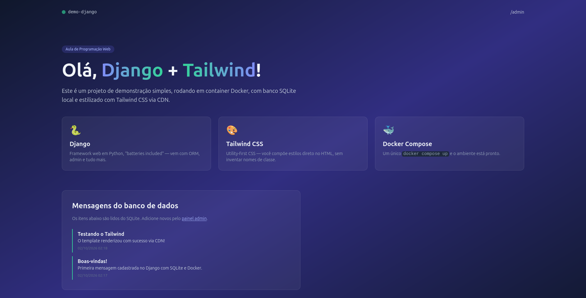
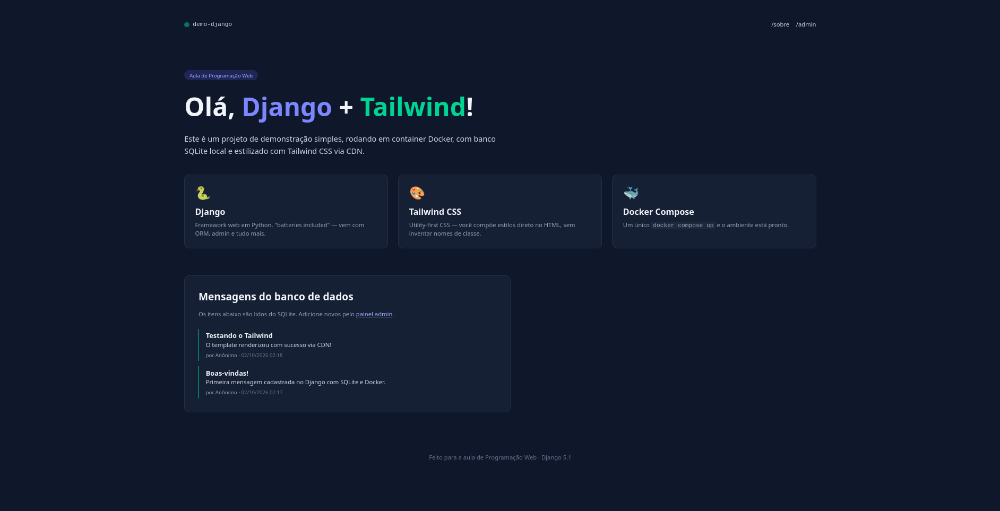
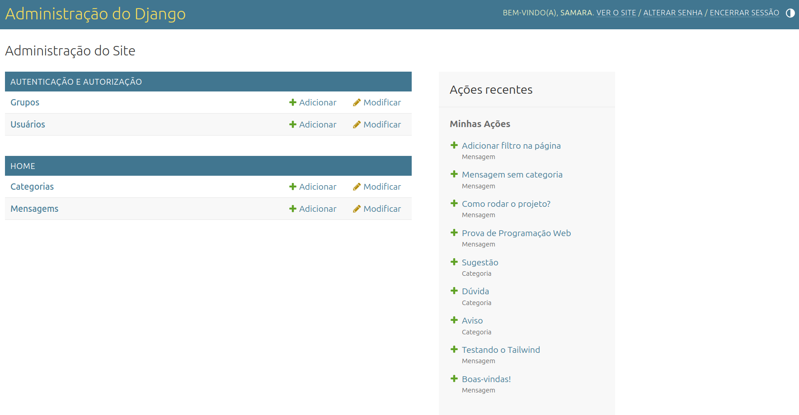
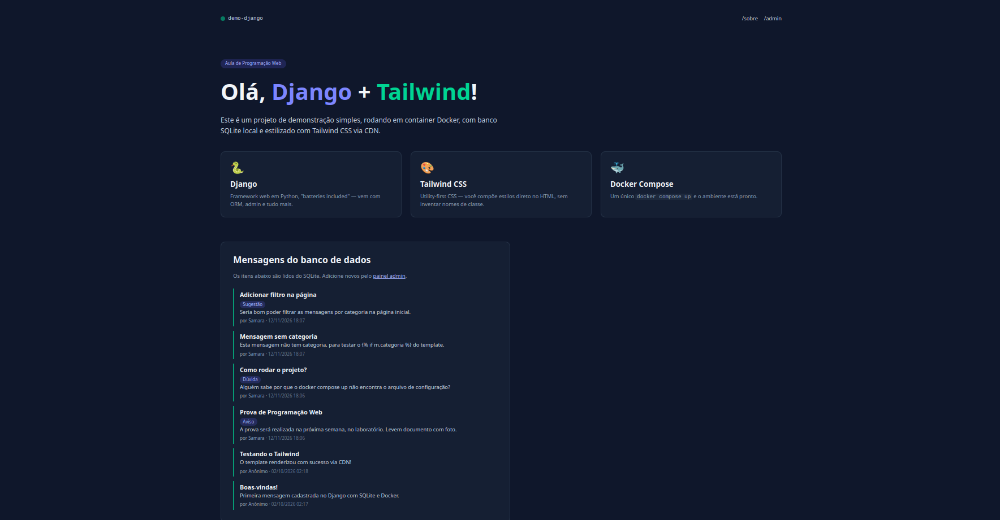

# Programação Web 

**Instituição:** Universidade Federal de Ouro Preto (UFOP)  
**Curso:** Ciência da Computação  
**Disciplina:** Programação Web  
**Professora:** Aline  
**Aluna:** Samara Paloma Lopes Augusto Ribeiro  

Repositório destinado ao armazenamento das atividades, roteiros práticos e projetos desenvolvidos ao longo da disciplina.

---

## Ementa
- Introdução à Internet, World Wide Web e sociedade da informação.
- Aplicações Web: evolução e arquitetura.
- Linguagens de marcação (HTML/HTML5, XML) e folhas de estilos (CSS).
- Programação do lado do cliente (Tailwind CSS, frontend).
- Abordagens e tecnologias do lado do servidor (Python & Framework Django - MTV).
- Padrões de projeto, requisitos de qualidade (usabilidade, desempenho, acessibilidade) e serviços Web.

---

## 📍 Roteiros Práticos

### Backend (Django)
- [x] **Roteiro 05:** Introdução ao Django (Projeto Inicial)
- [x] **Roteiro 06:** Criando modelos e rotas com Django
- [x] **Roteiro 07:** Criando modelos e relacionamento com Django

---

## Demonstração do Sistema em Execução

### Roteiro 05 - Aplicação Django Rodando (Parte 1)

### Roteiro 06 - Criando Modelos e Rotas com Django (Parte 2)

### Roteiro 07 - Criando Modelos e Relacionamento com Django (Parte 3)

Nesta parte foi criado o model `Categoria`, ligado a `Mensagem` por um relacionamento 1:N (`ForeignKey`), com registro no painel administrativo (incluindo filtro por categoria), migration aplicada e exibição da categoria na página inicial.

**Painel administrativo com Categorias e Mensagens**

**Página inicial exibindo as categorias das mensagens**

---

## 🛠️ Tecnologias
- HTML5 / CSS3
- Tailwind CSS
- Python / Django
- Git & GitHub
